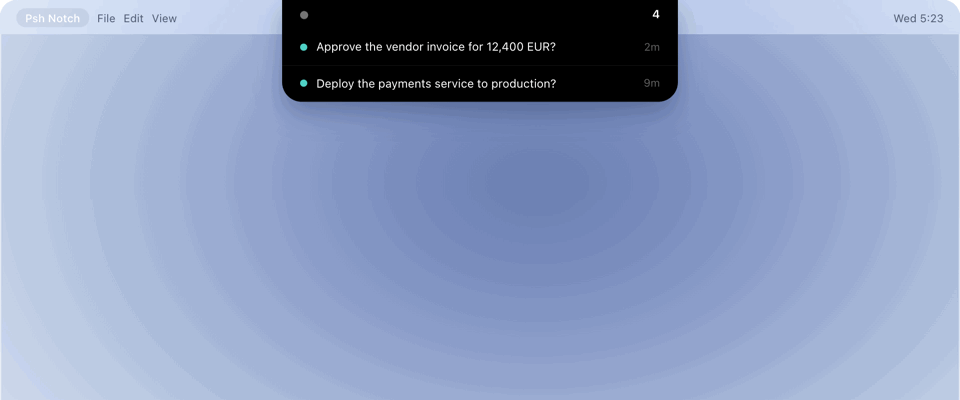

# psh.now

Human approval for AI agents: one host, one key, one boolean.



[](https://www.skills.sh/passy-ai/psh-now-skill)

An agent that needs a decision sends a short **title** and **message** to psh.now and blocks. You
tap **Approve** or **Deny** from one page, or answer in your own words, and the agent continues
with the result. It exists because agents stall in terminals nobody is watching.

- Works with any agent that can run a shell command or make an HTTP request. No SDK, no MCP.
- One page for every agent and every machine, including sandboxes you cannot attach to.
- Self hostable: MIT licensed, two containers, three environment variables.

```
┌────────────┐   blocking POST /        ┌────────────────┐   WebSocket    ┌─────────┐
│ AI agent   │ ───────────────────────► │ psh.now gateway │ ─────────────► │  phone  │
│ (terminal) │                          │  (Elysia +     │                │  (PWA)  │
│            │ ◄─────────────────────── │  Postgres)     │ ◄───────────── │         │
└────────────┘   { approved: true }     └────────────────┘  decision       └─────────┘
```

The request is a title and a message, not only a shell command: a command to run, an action to
take, or a question to answer.

**Where to go next**

| I want to | Read |
|---|---|
| install it and answer my first request | [Quick start](#quick-start) |
| run it on my own server | [self-hosting](https://psh.now/self-hosting) |
| understand the flow end to end | [the docs](https://psh.now/docs#overview) |
| call the API directly | [HTTP API](#http-api) |
| paste a prompt into an agent | [prompt templates](https://psh.now/docs#templates) |
| report a vulnerability | [SECURITY.md](SECURITY.md) |
| contribute | [CONTRIBUTING.md](CONTRIBUTING.md) |


## Stack

| Layer      | Choice                                                        |
| ---------- | ------------------------------------------------------------- |
| Runtime    | [Bun](https://bun.sh)                                        |
| HTTP / WS  | [Elysia](https://elysiajs.com)                               |
| Database   | PostgreSQL + [Drizzle ORM](https://orm.drizzle.team)          |
| Realtime   | WebSockets + Postgres `LISTEN/NOTIFY` (multi-node fan-out)   |
| Frontend   | Zero-build PWA (vanilla ES modules + service worker)         |

---

## Quick start

```bash
# 1. install
bun install

# 2. configure
cp .env.example .env          # then set DATABASE_URL / PUBLIC_BASE_URL
createdb psh.now                 # if it doesn't exist

# 3. migrate
bun run migrate

# 4. run the gateway
bun run dev                   # http://localhost:3000
```

Then, in the project you want to protect:

```bash
bun /path/to/psh/cli/psh.ts init
```

This creates a workspace, prints your API key once, saves it to `~/.psh/keys.json`
(mode 0600), and renders a pairing QR code. Scan the QR with your phone to open
the PWA, tap **Pair this device**, and you're live. The agent's rules file is the
block in [the integration section](#integration-the-rule-in-agentsmd-or-a-skill);
it refers to the key, so it stays safe to commit.

### Or create a channel in the browser

Open **`/setup`** (e.g. <http://localhost:3000/setup>). It creates a workspace,
shows the API key once, and renders the pairing QR. Pairing a device lands on
the dashboard, which immediately sends a **test approval** so you can confirm
alerts and the full approve/deny loop without a terminal. The dashboard's
**Send a test approval** button repeats it anytime, and **Invite** mints fresh
pairing codes from any already-paired device.

### Manual check

```bash
# commands, actions, and questions all use the same call
psh ask "Drop the users table and reseed?" --title "Database reset"
```

### Claude Code hook

Register the hook once in `.claude/settings.json`:

```json
{
  "hooks": {
    "PreToolUse": [
      {
        "matcher": "Bash",
        "hooks": [{ "type": "command", "command": "psh hook" }]
      }
    ]
  }
}
```

`psh hook` reads Claude's `PreToolUse` JSON on **stdin** and writes the
decision contract on **stdout** (`permissionDecision: "allow" | "deny"`). Every
Bash command waits for your phone. Non-Bash tools pass straight through. Set
`PSH_SKIP_PATTERN` to a regex to auto-allow read-only commands:

```bash
PSH_SKIP_PATTERN='^(ls|cat|git status|rg)\b' psh hook
```

---

## Using a hosted instance with your own key

Signing up gives you a workspace and one key. That key is the agent's credential: it
is what makes an ask appear in *your* account rather than someone else's.

1. **Get the key.** Open the hosted dashboard, create a workspace, and copy the key.
   It is shown once. The same page renders a pairing QR for a phone.
2. **Put it in the project, not a shell profile.** Install the skill inside the
   project you want the agent to work in; it writes `<project>/.psh/keys.json`
   (and a machine record at `~/.psh/keys.json`). Keys are per project on purpose, so
   two projects can belong to two different workspaces, and the file never belongs in
   version control.
3. **Ask.** `<project>/.psh/keys.json` is what the CLI and the skill's `psh` shim read,
   searching upward from the working directory. Nothing global has to be set.
4. **Approve from the notch or the phone.** The notch does not use the agent key at
   all: it pairs a device (dashboard: Devices, then Connect a device) and stores a
   per-device token at `~/.config/psh-notch/device.json`, mode 0600. That token can
   approve and read, cannot rotate keys, and can be revoked per device.

So the two credentials are separate on purpose: the **key** lets an agent *ask*, the
**device token** lets a human *answer*. Copying a key between machines moves the
agent; copying the device token moves the approval screen.

## Hosting & self-hosting

A hosted psh.now and a self-hosted one are the **same single process**. The only
thing that makes a deployment "public" is `PUBLIC_BASE_URL`:

```bash
PUBLIC_BASE_URL=https://psh.now
```

With that set, every generated pairing link becomes
`https://psh.now/pair/<code>`, openable from any phone, anywhere. The
agent endpoint is simply the same origin:

```bash
curl -s -X POST https://psh.now \
  -H "x-psh-key: psh_live_…" \
  -H "Content-Type: application/json" \
  -d '{"title":"Reinstall deps","message":"rm -rf node_modules && npm install --force"}'
```

The PWA derives its WebSocket URL from `location.host`, so serving over HTTPS
automatically yields `wss://…` with no rebuild. One instance serves many
isolated workspaces/tenants.

### The simplest deployment (no Docker, no reverse proxy)

Bun is the whole runtime. Point it at Postgres and run it:

```bash
cp .env.example .env          # set DATABASE_URL + PUBLIC_BASE_URL
bun src/db/migrate.ts
bun src/index.ts
```

That's it. Put it under systemd (or `tmux`/`pm2`), and you have a host node.

### HTTPS / WSS without Caddy

Bun terminates TLS itself, no Caddy, no nginx. Get a cert (e.g. from Let's
Encrypt) and point psh.now at it:

```bash
export TLS_CERT_FILE=/etc/letsencrypt/live/psh.now/fullchain.pem
export TLS_KEY_FILE=/etc/letsencrypt/live/psh.now/privkey.pem
export PUBLIC_BASE_URL=https://psh.now
bun src/index.ts
```

The server logs `https://…`, and the PWA automatically uses `wss://…`. If
`TLS_CERT_FILE`/`TLS_KEY_FILE` are unset, it serves plain HTTP (and says so on
boot). Use [`certbot certonly`](https://certbot.eff.org/) with a deploy hook to
renew, or any certificate you already manage.

> A reverse proxy is only useful if you *already* run one, want to host many
> services on one IP, or need automatic cert renewal without touching psh.
> `deploy/Caddyfile` is provided for that case, it is optional.

> **Blocking vs proxy timeouts.** `POST /` holds the connection open until a
> human answers. Cloudflare and many proxies cut an origin response off at
> ~100s (Cloudflare returns **524**). Keep `DEFAULT_TIMEOUT_MS` below your
> proxy's limit (the default is **90s**) or run psh.now directly / self-hosted
> without a CDN. The agent must treat a 524/timeout as **not approved** (the
> skill says so).

### Docker (optional)

`Dockerfile` + `docker-compose.yml` bundle Postgres and the gateway if you
prefer containers. They are not required and are not the default path:

```bash
cp .env.example .env
# edit PUBLIC_BASE_URL (or keep http://localhost:3000 for local)
docker compose up -d --build
```

Migrations are idempotent, so they are safe to run on every boot.

---

## Integration: the rule in `agents.md` (or a skill)

The whole wire-up is a host, a key, and one instruction. `psh init` mints the key
and pairs your phone; it does not write your agent's rules file. The block below
is safe to commit because it carries no credential: the HTTP form reads
`PSH_API_KEY` from the environment, and the installed `psh` CLI reads the key
from `~/.psh/keys.json`
(see [`templates/agents-snippet.md`](templates/agents-snippet.md)):

```md
## Ask before you act

Before any destructive, irreversible, or production action, ask first:

curl -s -X POST https://psh.now \
  -H "x-psh-key: $PSH_API_KEY" \
  -H "Content-Type: application/json" \
  -d '{"title":"<short label>","message":"<what you are about to do>"}'

Proceed only if the response is {"approved":true}. Otherwise do not act.
```

Where the skill or the installer has run, `psh ask "<short label>" "<what you are
about to do>"` is the same call and reads the key from `~/.psh/keys.json` itself.

Harnesses that support **skills** can load
[the skill](https://psh.now/skill.md) instead (or as well). It teaches
any LLM the same contract in the Anthropic Agent Skills / Hermes format, with a
`metadata.hermes` block, and adds guidance on *when* to ask and *when not* to.

Install the skill (same shape as here.now's):

```bash
# if you have npm/npx: one command, so the harness asks for approval once.
# It installs machine-wide and mints in the same run.
npx skills add passy-ai/psh-now-skill -g -y

# no npm? the hosted installer (works in a sandbox too, no credentials needed)
curl -fsSL https://psh.now/install.sh | sh
```

The key stays out of the repo. Either let `psh` read it from `~/.psh/keys.json`
(mode 0600, written by the installer), or export it in the environment the
agent runs in:

```bash
export PSH_BASE_URL="https://psh.now"
export PSH_API_KEY="psh_live_..."
```

The server hosts the skill and installer itself: `/skill.md`, `/install.sh`,
`/llms.txt`, `/llms-full.txt`, and the `/.well-known/*` manifests.

That is the entire integration surface for an arbitrary agent:

- **ask**: the model follows `agents.md` / the skill and calls the host. Any
  LLM with shell or HTTP tool access can do this.
- **gate**: `psh hook` wired into a harness's pre-tool hook, which cannot be
  skipped. Optional, and only where the harness supports it.

> `agents.md` holds the rule, not the key: nothing in it is a secret, so it is
> safe to commit. The key lives in `~/.psh/keys.json` (0600) or `PSH_API_KEY`.

---

## How the block works

1. **Agent → gateway.** The agent `POST`s `{ title, message, kind?, cwd?, agent? }`
   to `POST /` (or `/api/v1/hook`) with header `x-psh-key`. (`command` is still
   accepted as a legacy alias for `message`.)
2. **Risk scan.** The title + message are scanned against a rule set
   (`rm -rf`, `--force`, `sudo`, `curl | sh`, `DROP TABLE`, force-push, …) and
   bucketed `low → critical` with human-readable reasons.
3. **Hold.** The request's promise is parked in an in-process waiter registry
   with a timeout. The HTTP connection stays open, the terminal freezes.
   **Async option:** send `wait:false` and the call returns at once with a
   `pollUrl`, so nothing blocks and no proxy/CDN timeout can cut it off. Poll
   with `GET /api/v1/prompts/:id?wait=30`.
4. **Alert.** The prompt is broadcast to every paired device for that tenant.
5. **Decision.** The phone sends `{ type: "decision", promptId, approved }` over
   its WebSocket (or `POST /api/v1/prompts/:id/decision` as a fallback). The
   decision is persisted atomically (`pending → approved/denied`), fanned out
   over `NOTIFY psh_decisions`, and the waiter resolves.
6. **Unblock.** The agent receives `{ approved: true|false }` and acts.

Timeouts and dropped agent connections auto-deny (`status: "expired"`), so a
lost phone can never wedge a build forever. Pending prompts whose answer window
has passed are swept to `expired` (async requests have no waiter to time out).

---

## HTTP API

| Method   | Path                              | Auth          | Purpose                                |
| -------- | --------------------------------- | ------------- | -------------------------------------- |
| `POST`   | `/` · `/api/v1/hook`              | `x-psh-key`  | Approval request (blocking, or `wait:false`) |
| `POST`   | `/mcp`                            | `x-psh-key`  | MCP: one tool, `psh_ask` (streamable HTTP, JSON) |
| `GET`    | `/.well-known/mcp.json`           | - | MCP descriptor for clients and scanners |
| `POST`   | `/api/v1/channels`                | - | Provision workspace (+ `pair:true` for a pairing link) |
| `POST`   | `/api/v1/claims`                  | key / device  | Request a claim code for an anonymous workspace |
| `POST`   | `/api/v1/claims/:id/verify`       | - | Verify the code; makes the workspace permanent |
| `POST`   | `/api/v1/pairing`                 | key / device  | Mint a pairing link/QR                 |
| `GET`    | `/api/v1/qr`                      | - | Render any string as an SVG QR code    |
| `GET`    | `/api/v1/pairing/:token`          | - | Validate a pairing token               |
| `POST`   | `/api/v1/pairing/:token/claim`    | - | Exchange token for a device token      |
| `GET`    | `/api/v1/me`                      | `x-psh-key`  | Workspace overview                     |
| `GET`    | `/api/v1/prompts`                 | key / device  | List prompts (`?status=`, `?limit=`)   |
| `GET`    | `/api/v1/prompts/:id`             | key / device  | Fetch a prompt; `?wait=<s>` long-polls   |
| `POST`   | `/api/v1/prompts/:id/cancel`      | key / device  | Cancel a pending request               |
| `POST`   | `/api/v1/connections`           | key / device  | Register a connection (agent/project) |
| `GET`    | `/api/v1/connections`           | key / device  | List connections (one account → many)  |
| `GET`    | `/api/v1/connections/:id`       | key / device  | A connection and its requests          |
| `DELETE` | `/api/v1/connections/:id`       | key / device  | Delete a connection                    |
| `POST`   | `/api/v1/test`                    | key / device  | Send a non-blocking test approval      |
| `POST`   | `/api/v1/prompts/:id/decision`    | key / device  | Decide over HTTP (WS fallback)         |
| `GET`    | `/api/v1/devices`                 | key / device  | List paired devices                    |
| `DELETE` | `/api/v1/devices/:id`             | key / device  | Revoke a device                        |
| `GET`    | `/api/v1/keys`                    | key / device  | List agent keys                        |
| `POST`   | `/api/v1/keys`                    | key / device  | Mint a recoverable agent key           |
| `GET`    | `/api/v1/keys/:id/reveal`         | key / device  | Reveal a key's raw value to the operator |
| `DELETE` | `/api/v1/keys/:id`                | key / device  | Revoke an agent key                    |
| `GET`    | `/api/v1/health`                  | - | Health probe                           |
| `WS`     | `/ws?token=<deviceToken>`         | device token  | Live prompt stream + decisions         |

Interactive docs at **`/docs`** (Swagger).

### MCP

The HTTP call is the contract; MCP is a second front door for clients that cannot install a
skill (hosted builders, connector UIs, apps that only speak the protocol). One endpoint, one
tool, no OAuth, no server-initiated stream -- a thin JSON-RPC wrapper around the same handler,
so metering, expiry and the decision path cannot drift between the two surfaces.

```bash
claude mcp add --transport http psh https://psh.now/mcp --header "x-psh-key: psh_agent_..."
```

```json
{ "mcpServers": { "psh": { "url": "https://psh.now/mcp",
    "headers": { "x-psh-key": "psh_agent_..." } } } }
```

`psh_ask` takes `{title?, message, timeoutSec?}`, blocks, and returns
`{"approved":bool,"status":"approved|denied|answered|expired","answer":string|null,"promptId":"..."}`.
Only `approved: true` means yes; `denied`, `expired` and errors all mean do not act. MCP is
cooperative like the skill: it cannot stop an agent that never calls it. The gate is the hook.

Protocol details, error codes and the reasoning behind the smaller surface: [the MCP section of the docs](https://psh.now/docs#mcp).

### WebSocket frames

Server → phone:

```jsonc
{ "type": "hello",         "workspace": {…}, "device": {…}, "pending": [...] }
{ "type": "prompt.created", "prompt": { "id": "pr8x1k…", "title": "Reinstall deps", "message": "rm -rf node_modules", "kind": "command", "risk": "critical", "riskReasons": [...] } }
{ "type": "prompt.decided", "promptId": "…", "approved": true }
```

Phone → server:

```jsonc
{ "type": "decision", "promptId": "pr8x1k…", "approved": true, "reason": "ok" }
{ "type": "ping" }
```

---

## Security model

- **API keys** are shown exactly once and stored only as SHA-256 hashes.
- **Device tokens** are random, stored hashed, and revocable per device.
- **Pairing tokens** are single-use and expire (default 10 min).
- **Short IDs.** All public identifiers are base62, ≤ 32 chars, so every URL
  stays YouTube-short (`/pair/UpDbWPKjQjoAqVtLdehnwQ`).
- **Short-lived credentials only** cross the wire; no secrets are ever sent to
  the agent or embedded in URLs after pairing.
- **Every decision is audited** in the append-only `audit_log`.

---

## Multi-node / scaling

The blocked promise lives on the node that accepted the agent request; the
phone may be connected to a different node. `NOTIFY psh_decisions` broadcasts
every decision to all nodes, and each node resolves any matching local waiter.
No sticky sessions, no Redis required. Postgres is the only coordination
primitive.

---

## Project layout

```
src/
  index.ts            Elysia app + graceful shutdown
  env.ts              Validated configuration
  db/
    schema.ts         Drizzle tables (tenants, devices, prompts, …)
    index.ts          postgres.js pool + Drizzle client
    migrate.ts        Migration runner
  lib/
    ids.ts            Short base62 ID generator
    crypto.ts         API key generation, SHA-256, header parsing
    risk.ts           Command risk scanner
    waiters.ts        In-process blocked-request registry
    realtime.ts       WebSocket per-tenant hub
    pubsub.ts         Postgres LISTEN/NOTIFY fan-out
    tenant-auth.ts    Request authentication
    http.ts           Typed HTTP errors
  services/           Business logic (tenants, devices, prompts, decisions)
  routes/             auth · hook · prompts · ws
public/               PWA (index/pair HTML, app.js, sw.js, manifest)
cli/psh.ts           init · pair · ask · hook · status · doctor
tests/e2e.ts          Full approval-loop integration test
drizzle/              Generated SQL migrations
```

---

## Testing

```bash
bun tests/e2e.ts      # boots the gateway, pairs a fake phone, exercises approve/deny/timeout
bunx tsc --noEmit     # type check
```

---

## CLI

```
psh init        Create a workspace + pairing QR
psh pair        Mint a new pairing link
psh ask "cmd"   Block until a human approves/denies  [--timeout <seconds>]
psh hook        Agent hook (reads JSON on stdin)
psh status      Workspace + pending requests
psh doctor      Connectivity + credential check
```

---

## Licence

MIT, Copyright (c) 2026 Absolum. See [LICENSE](LICENSE). The hosted instance at
[psh.now](https://psh.now) is a service, not part of this licence.
