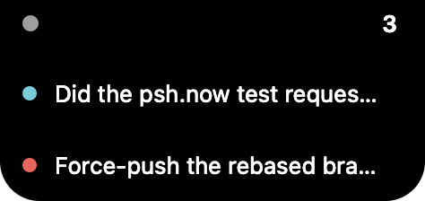

# psh-notch

Approve psh.now requests from the macOS menu bar, and from the notch when the
display has one. One Swift file, AppKit only, no dependencies, no Xcode project.

```bash
cd tools/psh-notch
swiftc -parse-as-library -swift-version 5 -O -o psh-notch PSHNotch.swift

./psh-notch --geometry                          # what this display offers the notch
./psh-notch --render preview.png                # draw the card offscreen and write a png
./psh-notch --render bubble.png --answer        # the same card with the answer field open
./psh-notch --layout                            # where the pieces land, open and closed
./psh-notch --preview --seconds 4               # show the real panel for a moment
./psh-notch --preview --answer                  # ...and report whether it can be typed into
./psh-notch --pair https://psh.now/pair/…  # or the dashboard's Connect device link
./psh-notch                                     # menu bar item, live
./psh-notch --selftest                          # headless: decide the first waiting request
./psh-notch --selftest --answer "not yet"       # headless: answer it instead
```

## Install on another Mac

Two commands and a pairing link. No dependencies, no Xcode project, no installer.

Requirements: macOS 13 or later, and Xcode Command Line Tools for `swiftc`
(`xcode-select --install` once, if `swiftc` is not already there).

```bash
# 1. build it (about five seconds)
cd tools/psh-notch
swiftc -parse-as-library -swift-version 5 -O -o psh-notch PSHNotch.swift

# 2. pair it, using the link from the dashboard's Devices page:
#    Devices -> Connect a device -> copy the link
./psh-notch --pair https://psh.now/pair/<token> --name "MacBook Air"
```

Then `./psh-notch` shows a "psh notch" item in the menu bar and lives at the notch.
The pairing link is single use and expires quickly; the dashboard makes a fresh one
each time, and an already-paired device can make one for another device without
touching the account secret.

### Connecting without pasting anything

If you are signed in on the dashboard, nobody has to copy a link or a token:

1. Click **psh notch** in the menu bar, then **Settings → Connect this Mac…**. The browser opens
   `/connect` on the dashboard you are signed in to.
2. Click **Connect psh notch**. The page mints a device token through the same
   pairing route the QR code uses, claims it, and hands it to the app as
   `psh-notch://paired?token=…&host=…`.
3. The notch writes the token to `~/.config/psh-notch/device.json` (0600) and the menu
   says **Live**. The account secret key is only used by the browser page to mint the
   token; it is never sent to the app and never written by it.

The handover only works for the built app: the `psh-notch://` scheme lives in the
bundle's `Info.plist`, so a bare binary run from a terminal cannot receive it. For that
case use the fallback, which the same page prints after the click:

```bash
./psh-notch --handle-url 'psh-notch://paired?token=<device token>&host=https://psh.now'
```

`--handle-url` validates the URL, refuses anything that is not `psh-notch://paired`
with a plausible token and an http(s) host, and writes the same 0600 file.

To go back to being unpaired, use **Settings → Disconnect** in the menu, or
`./psh-notch --unpair`. Both remove only `~/.config/psh-notch/device.json`: the
workspace, the agent's key files and the device record on the server are untouched.
Revoking the device on the dashboard's Devices page is the server-side half of
disconnecting, and it is the half that matters if the machine is lost.

### The profile key is the pairing link, not the account key

There is nothing to configure by hand. The one thing that identifies this Mac is the
**device token** that pairing mints, and it is written here:

```
~/.config/psh-notch/device.json      # 0600, owner only
```

Copying that file to a second Mac is the same as pairing it: both then act as one
device. Do not copy the account secret key anywhere, and do not put either in a shell
profile. To move the notch to a new machine, pair again from the dashboard instead of
copying the file, then revoke the old device on the Devices page; revocation takes
effect on the next reconnect.

### The dmg, and the one warning

`./package.sh` builds `dist/psh notch.app` and wraps it in `dist/psh-notch.dmg`
(about 210 KB). The bundle sets `LSUIElement`, so it is a menu bar app: no Dock icon and
no window when it starts.

The bundle is named `psh notch.app` on purpose: Finder, Spotlight, Raycast and Login Items
read the file name, so this is the name those lists show. The executable inside stays
`PSHNotch`, which is what `CFBundleExecutable` points at.

Open the dmg, drag **psh notch** to Applications, and launch it.

Launch at login points at the copy that registered it. An app first opened from a build
folder keeps that folder as its login item after it is moved, and then comes back at the
next reboot from a path that no longer exists. The installed copy fixes that in one line:

```sh
/Applications/psh\ notch.app/Contents/MacOS/PSHNotch --login-item on
```

`off` and `status` do the other two things, and the menu item does the same by hand.

The **first** launch of that copy shows a warning and refuses to open. Right-click the
app, choose **Open**, and confirm **Open** in the dialog. Or open System Settings >
Privacy & Security and press **Open Anyway** beside the app's name. After that it
starts normally and never asks again for that copy.

That warning is expected, and it is not a damaged download. The app is signed ad hoc
with no Developer ID behind it, so there is no notarisation receipt for macOS to check:
`security find-identity -v -p codesigning` returns **0 valid identities** on this
machine, which is the whole reason. The alternative that removes the step entirely is
an Apple Developer Program membership (99 USD/year) plus notarisation; until then, the
right-click is the price.

Connect it once after installing, either way:

- **Connect this Mac…** in the menu bar, then **Connect psh notch** in the browser (see
  "Connecting without pasting anything" above), which needs no typing at all;
- or, from a terminal, `--handle-url 'psh-notch://paired?…'` with the link the connect
  page prints, or the older `--pair <dashboard link> --name "MacBook Air"`.

### Start it at login

A LaunchAgent keeps it running without leaving a terminal open:

```bash
mkdir -p ~/Library/LaunchAgents
cat > ~/Library/LaunchAgents/dev.psh.notch.plist <<PLIST
<?xml version="1.0" encoding="UTF-8"?>
<!DOCTYPE plist PUBLIC "-//Apple//DTD PLIST 1.0//EN" "http://www.apple.com/DTDs/PropertyList-1.0.dtd">
<plist version="1.0"><dict>
  <key>Label</key><string>dev.psh.notch</string>
  <key>ProgramArguments</key>
  <array><string>$HOME/Projects/Pushy/tools/psh-notch/psh-notch</string></array>
  <key>RunAtLoad</key><true/>
  <key>StandardOutPath</key><string>/tmp/psh-notch.log</string>
  <key>StandardErrorPath</key><string>/tmp/psh-notch.log</string>
</dict></plist>
PLIST
launchctl load ~/Library/LaunchAgents/dev.psh.notch.plist
```

Adjust the path if the checkout lives somewhere else, then `launchctl unload` and
`load` again after moving the binary.

### Checking it worked

```bash
./psh-notch --selftest     # pairs? reachable? what is waiting?
tail -f /tmp/psh-notch.log # one line per event
```

A menu bar item that offers "waiting 0" is paired and connected. If it says it is not
paired, the token file is missing or was written by a different host.

### Updating

Copy the new `PSHNotch.swift` over the old one and run `./restart.sh`; it rebuilds only
when the source is newer and restarts exactly one instance.

## The credential: a device token, not the account secret

The app needs **one** secret, and it is not the workspace secret key. Pairing mints
a device token that can approve and read its own account, and that can be revoked
from the dashboard's Devices page without touching anything else:

| | account secret key | device token |
| --- | --- | --- |
| scope | `manage` | `approve` |
| can rotate keys, delete the account | yes | no |
| revocable per device, with `lastSeenAt` | no | yes |
| what this app stores | never | `/…/device.json`, mode 0600 |

A token cannot be turned back into the account, which is the property that makes it
safe to keep in a file on a laptop.

Pairing is three calls, and the dashboard already drives all of them:

```bash
# 1. from the dashboard, with an account key, mint a pairing link (valid briefly)
curl -s -X POST $HOST/api/v1/devices/pairing -H "x-psh-key: $USER_KEY"
#    -> { url: "$HOST/pair/<token>", qrUrl, expiresAt }

# 2. the new device claims it, once
curl -s -X POST $HOST/api/v1/pairing/<token>/claim \
  -H 'content-type: application/json' -d '{"name":"MacBook Pro notch"}'
#    -> { workspaceId, device:{id,name,pairedAt}, deviceToken, wsUrl }
```

Step 1 wants an approving key, so the notch app can also re-pair a second device
later without an account secret.

## Staying live

`wsUrl` is `wss://<host>/ws`, and the token travels as a query parameter because
that is what the route reads (`src/routes/ws.ts`):

```
wss://psh.now/ws?token=<deviceToken>
```

The socket carries everything the UI needs:

| frame | direction | payload |
| --- | --- | --- |
| `hello` | server, on connect | `workspace`, `device`, `pending[]`, `serverTime` |
| `prompt.created` | server push | the whole request, so a new ask appears without polling |
| `prompt.decided` | server push | another device (or the dashboard) already answered |
| `decision` | client | `{ type, promptId, approved, answer? }` |
| `decision.ack` | server | `{ promptId, applied }` |
| `ping` / `pong` | both | keeps a paired device's `lastSeenAt` fresh |

REST is the fallback and is what a paired phone already uses, with the token in its
own header rather than `x-psh-key`:

```
x-psh-device: <deviceToken>
GET  /api/v1/approvals?status=pending      # what is waiting
GET  /api/v1/channels                      # id -> name, so a card can say which channel
POST /api/v1/approvals/<id>/decision       # {"approved":true} or {"answer":"…"}
```

## The notch

There is no API for drawing *inside* the notch, because the notch is a hole in the
panel. What notch apps do is hang a borderless panel from the top edge of the
screen, centred on the cutout and extending below it, so it reads as the notch
opening downward. The geometry comes from three AppKit properties, all macOS 12+:

```swift
let insets = screen.safeAreaInsets                    // top = the notch's height
let left   = screen.auxiliaryTopLeftArea              // the menu bar strip left of it
let right  = screen.auxiliaryTopRightArea             // and right of it
let cutout = NSRect(x: left.maxX, y: left.minY,       // the gap between them
                    width: right.minX - left.maxX,
                    height: insets.top)
```

On the Mac this was written on (macOS 26.5, 1512x982 points) that reports:

```
safe-area top 32
cutout x 663 to 848 (185 wide)
panel  460x168 centred under it
```

`--geometry` prints exactly that, so the anchoring can be checked without a GUI.

The panel itself is an `NSPanel` with `.borderless, .nonactivatingPanel`,
`level = .statusBar`, `collectionBehavior = [.canJoinAllSpaces,
.fullScreenAuxiliary, .stationary]`, a clear background and a black content view
rounded at the bottom only. `nonactivatingPanel` matters: clicking Approve must not
pull focus away from the editor the human is working in.

Two things worth knowing before building the full app:

- **A notched display is not guaranteed.** `safeAreaInsets.top > 0` is the test, and
  a display without a notch falls back to a menu bar item. The menu bar is also the
  only place that exists on every Mac, which is why this prototype keeps
  `NSStatusItem` as the primary surface and treats the notch panel as the layer that
  appears when something is waiting.
- **`MenuBarExtra` (SwiftUI, macOS 13+) is the short path** if the menu bar is
  enough: a few lines instead of a status item, but it cannot render outside the
  menu bar. For the real notch behaviour, [DynamicNotchKit](https://github.com/MrKai77/DynamicNotchKit)
  wraps the panel, the hover expansion and the multi-display cases; taking it would
  mean a SwiftPM dependency, which this prototype deliberately does not have.

## The card

## The three states

Waiting requests do not take the screen. The pointer moves the panel between three states:

| state | what it is | how it gets there |
| --- | --- | --- |
| compact | two capsules either side of the notch: the request colour on the left, pulsing, the number waiting on the right | a request is pending |
| list | one row per waiting request, a dot and a name each | the pointer enters the panel |
| detail | the whole request, with its three actions | a row is clicked |


The waiting state is two 26pt capsules in the 32pt menu bar strip, 2pt either side of the
cutout, flush with the top of the display and square across the top with round bottom corners,
the way the notch's own chin is. A waiting request costs no height below the notch at all and
never covers the work or the notch. No titles are shown while waiting and nothing pulses: the colour alone is the
signal. The list and the full request grow right and down from the capsule's own
top left corner, which keeps the pointer that opened them inside the panel. It sits over whatever
menu titles are in the menu bar while requests wait, which is the price of the position. Nothing carries an agent logo, and
the count is plain text with no background of its own. The dot is the server's own risk reading
of the request: red for high, amber for medium, teal otherwise, so it says something rather
than decorating.



Leaving the panel puts it back to the one line, with one exception: while the answer field is
open the panel stays, because the pointer leaving is not a reason to take the keyboard away
mid-sentence. A request that arrives while someone is typing is added to the list behind the
field instead of replacing it.

Title and subtitle, then the three actions underneath, on the same black. Text and actions are
left-aligned at the same 20pt margin the dot sits on in the waiting line, so opening a request
does not re-centre the panel: it reads as the same object in every state. Sized to the
screen, it settles at 460x222 with its top edge flush with the top of the display, so
the black strip at the top reads as the notch itself and the card appears to unroll
out of it (0.26s, ease-out, from a 32pt strip to full height).


With the bubble open, the bubble has moved to the left and the field is beside it as an
outline on the same black, at the same card height: `--render bubble.png --answer`.

The two verdicts are ringed circles, red and green, and the middle action is a
ringless grey bubble on purpose: an answer is a typed reply, which is neither a yes
nor a no (`status: "answered"` in the API), so it should not look like a third
verdict sitting between the other two. Hovering fills the ring at 16 percent and
brightens the glyph.

The rings are drawn as circle *paths*, not as a corner radius on the layer. A radius
follows the layer's bounds, so any height a button picks up turns the ring into a
rounded square on screen, which is exactly what happened on the first real display.
A path cannot drift like that.

The panel is pure black, with no border line and no shadow: every sampled point inside it,
including behind the icons and in the notch strip, is exactly `rgb(0,0,0)` in the render. The
bar behind the icons used to be `rgb(19,19,20)`, which is a visible grey band on a real screen,
and that is the one thing inside the panel that was not black. Its bottom corners are round: on a MacBook Pro the display and the bottom of the notch are round, and a square
panel next to them reads as a window rather than as the notch. Only the bottom is round.
The top edge sits flush with the top of the display, where the shape is square, and a
rounded corner there would let the wallpaper show through beside the notch. The radius is
22pt by default and `--corner <pt>` overrides it for a render; no API reports what the
hardware actually uses, so it is a number to look at rather than a measured one.

Tapping the bubble does not open anything below the card. The field is the fourth view in
the bar: the two verdicts step aside, the bubble slides to the left edge, and the field
opens beside it as a black field with a hairline edge, 14pt on one line and focused. At the
end of the field is a grey circle with a white arrow, so the end of the line says what it
does. A lighter fill was the obvious choice
and the wrong one: anything lighter than the panel is the grey band again. The card keeps its height, and the
whole move is one 0.22s ease-out (`--layout` prints where each piece lands). Escape closes
it and puts the verdicts back, Return sends.

This is also where the one real bug lived. **A borderless `NSPanel` cannot become key**, so
nothing could be typed into it and a separate alert could not be typed into either.
`NotchPanel` overrides `canBecomeKey`, the bubble declares `needsPanelToBecomeKey` (the
verdicts deliberately do not, so clicking them never pulls focus), and key status is asked
for again one run-loop turn later, because AppKit re-decides it after the click that opened
the field. The client logs the outcome of both attempts, which is how the second attempt was
judged rather than guessed.

The card is one view (`NotchCardView`), so all three surfaces are the same code: the
live app, `--preview` (which builds the real panel through the same presenter), and
`--render` (which draws it offscreen into a PNG). Those two exist so the design and
the keyboard can be checked without covering the screen, and `preview.png` was made
with the first of them.

## What is verified, and what is not

Verified against the live host on 2026-10-18:

- pairing a scratch account, claiming the link, and the token landing on disk `0600`
  with no account secret in it
- the socket connecting, receiving a waiting request in `hello`, sending a decision,
  and reading back `applied=true`, with the server then reporting `status=approved`
- the device appearing on the account with `pairedAt` and a `lastSeenAt` that the
  ping refreshed
- the same device approving over REST with `x-psh-device`, and getting `403` on an
  admin route, `401` on an unknown token, and `401` after revocation
- answering rather than deciding, with the words surviving: `status=answered` and the
  `answer` column holding the sentence, both over the socket (from this client) and
  over REST (in the flow, with a device token)
- the answer field taking the keyboard: the handover reports `key=true caret=true`, which
  is exactly what the borderless panel could not do before
- a person typing into it for real: on 2026-10-18 at 20:36:47 an answer arrived carrying
  the sentence the human had typed, which is also how the next fix was requested
- `--geometry` against the real display
- the panel settling at 460x222 with its top edge 0pt from the top of the screen, over
  a 32pt notch, with the pop-out animation running to completion
- the card rendering to `preview.png`, which is what the image above is
- where each mode puts its rows on the screen, from `--modeprobe`: the compact line 32 to 76pt
  below the top of the display, and the list's first row 32 to 72pt, so no row lands under the
  notch. That check found a real bug. The view was pinned to the bottom of its host while the
  window was still short, so growing the panel drew the list 44pt *above* the top of the
  display, under the notch, and the same bug is why the panel seemed to vanish when the pointer
  left it instead of settling back to the one line
- the card's corners, by decoding the render rather than by eye: the straight parts of both
  side edges and the whole top edge are opaque, and the two bottom corners are not, at 12,
  22 and 32pt. That check paid for itself twice: `maskedCorners` is ignored on a
  view-backed layer, which rounded the top corners too, and an `NSBezierPath` arc for the
  bottom-left corner swept the long way round and cut a diagonal across the left edge

Not verified: the open animation itself. A headless run can only reduce it to end states,
which is what `--layout` prints (`closed: bubble x 164 w 44, field hidden` -> `open: bubble
x 0 w 44, field x 54 w 318`), and that is not the same as watching it move.

Partly verified by real use: two requests on a real account were approved from a running
client on 2026-10-18 (the server logged `status=approved` at 20:27:56 and 20:27:57), so a
click does reach the socket. Nothing in the log distinguishes a panel button from the menu
bar item, so what was clicked is not known from here.

## What building this surfaced

A real regression, in the app rather than the client. The scope guard in
`src/index.ts` accepted `x-psh-key` and ignored `x-psh-device`, so a paired phone
got `401` on every approve-scoped REST route, including the decision route, while
the websocket path kept working. `public/app.js` sends that header, so the shipped
dashboard was affected. Fixed by treating a resolved device token as `approve` and
never `manage`, and covered by step 4b of `.verify/local-flow.sh` so it cannot come
back unnoticed. The flow had 79 assertions before this and none of them paired a
device, which is exactly how it passed twice while this was broken.

One server-side improvement worth making: `ws.ts` reads the token from the query
string only, so it ends up in proxy and access logs. Accepting
`Authorization: Bearer <deviceToken>` on the upgrade would let a native client keep
it in a header, the same way `x-psh-device` does over REST.
